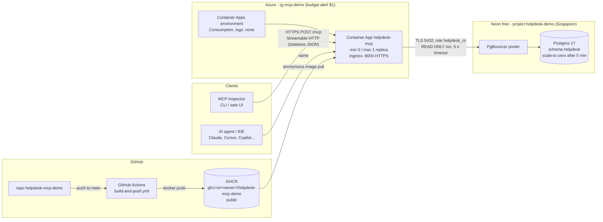

# Architecture

## Request path
1. Client sends JSON-RPC (`initialize`, `tools/list`, `tools/call`) to `https://<app>.<env>.<region>.azurecontainerapps.io/mcp`.
2. If no replica is running, Container Apps holds the request while one starts (cold start, a few seconds).
3. `HostGuard` checks Host/Origin against `ALLOWED_HOSTS` (DNS-rebinding protection); optional `BearerAuth` checks `MCP_API_KEY`.
4. The MCP SDK (`MCPServer`, stateless Streamable HTTP) validates arguments against each tool's schema.
5. Each SQL query runs in its own transaction: `SET TRANSACTION READ ONLY`, `SET LOCAL statement_timeout`, `SET LOCAL search_path` and then parameterised SQL. That works through Neon's PgBouncer transaction pooling.
6. Neon resumes the compute if it was suspended (a few hundred ms) and answers.
7. After 300 s without requests, Container Apps scales to zero. After 5 min idle, Neon suspends. The idle cost is then storage only.

## Security layers (demo-grade)
| Layer | Control |
|---|---|
| Data | Entirely synthetic (`@example.com`), so a leak exposes nothing real |
| DB | `helpdesk_ro` has SELECT only, `default_transaction_read_only=on` and a 5 s timeout. The server also forces read-only transactions |
| App | Input validation (enums, lengths, limit ≤ 50, date checks); no dynamic SQL from input |
| Transport | HTTPS from Container Apps ingress; Host/Origin allow-list |
| Auth | None by default (learning demo). Set `MCP_API_KEY` for a shared bearer token. For production, use OAuth 2.1 per the MCP authorisation spec (e.g. Entra ID) |
| Writes | `create_ticket` and `update_status` are not even registered unless `ENABLE_WRITES=true` |
