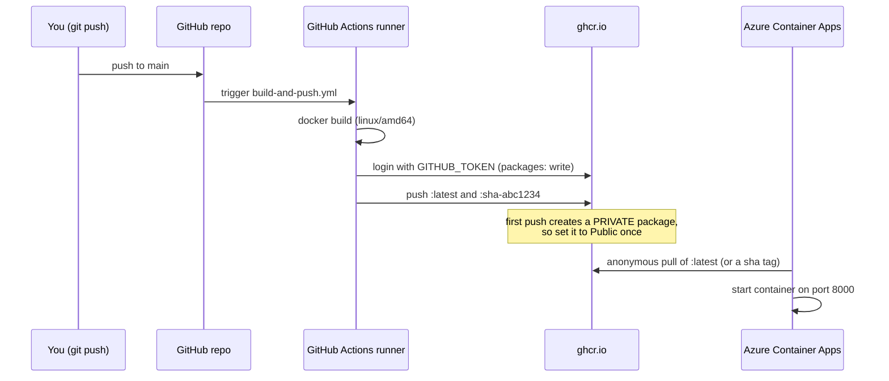

# GHCR and GitHub Actions, explained simply

**A container image** is a zip-like bundle holding the app plus everything it needs to run (Python, libraries, our code). Build it once and it runs the same anywhere.

**A container registry** is a library for images. Cloud services (like Azure Container Apps) pull images from it.

**GHCR (GitHub Container Registry)** is GitHub's registry at `ghcr.io`. Images live under your account, e.g. `ghcr.io/<owner>/helpdesk-mcp-demo`, next to your code. **Public images are free**: anyone can pull them anonymously, so Azure needs no registry password.

**GitHub Actions** is GitHub's built-in automation. A workflow file (`.github/workflows/build-and-push.yml`) says "when code is pushed to `main`, build the image and push it to GHCR".

## Key points
- **No secrets to manage for the push.** `GITHUB_TOKEN` is a short-lived token GitHub creates for each run. The workflow grants it `packages: write`.
- **Tags:** `latest` always points at the newest build of `main`. `sha-<7 chars>` is pinned to an exact commit, which is better for repeatable deploys and rollbacks.
- **Visibility:** the first push creates the package as *private*. Make it public once: GitHub → your profile → Packages → `helpdesk-mcp-demo` → Package settings → Change visibility → Public. A private package would need Azure to hold a GitHub token.
- **Updating Azure:** a new image does **not** auto-deploy. Run `az containerapp update ... --image ghcr.io/<owner>/helpdesk-mcp-demo:sha-<sha>`, or enable the optional `deploy` job (OIDC, no passwords stored).
- **Cost:** GitHub says Packages usage is free for public packages, and container image storage and bandwidth for GHCR is currently free. Public-repo Actions minutes on standard runners are free.
